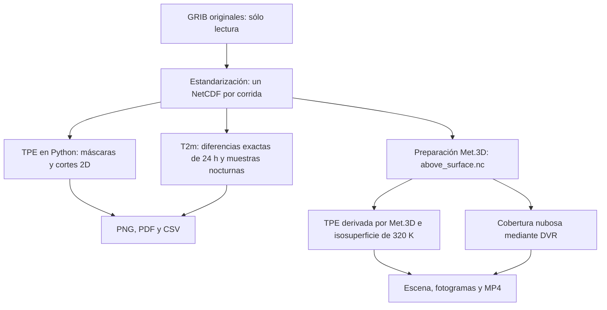

# Friaje: flujo de cálculo y visualización 2D y Met.3D

**Fecha de revisión:** 2026-11-04.  
**Alcance:** describir el código y las configuraciones implementadas, los
productos generados y las comprobaciones registradas. Es una descripción
del estado actual; no certifica un evento meteorológico ni fija nuevos criterios.

## 1. Qué se implementó

El trabajo combina tres productos que parten del NetCDF estandarizado:

| Producto | Cálculo principal | Representación | Salidas |
|---|---|---|---|
| TPE 2D | TPE desde temperatura, humedad específica y presión | Cortes a 925/850/700 hPa; azul para TPE < 320 K, contorno de 320 K y viento | PNG por tiempo, PDF y CSV |
| Temperatura a 2 m | Temperatura en °C y descenso entre horas separadas exactamente 24 h | Mapas, máximos por celda, series y comparación nocturna a hora fija | PNG, PDF, CSV y resumen Markdown |
| Friaje en Met.3D | Máscara bajo superficie en Python; TPE derivada dentro de Met.3D | Isosuperficie de 320 K entre 1000–700 hPa y DVR de cobertura nubosa entre 1000–100 hPa | Configuraciones temporales, NetCDF de visualización, fotogramas y MP4 |

El umbral de 320 K procede de la propuesta operativa del usuario. No se
implementó un detector automático de friajes ni se validó una fecha definitiva.
La escena del producto 3D y del análisis TPE conserva `south_america`.
El flujo Met.3D reutiliza la preparación general de DANA y jet.



## 2. Archivos que permiten seguir el flujo

Todas las rutas de esta sección son relativas a la raíz del proyecto.

| Función | Archivos |
|---|---|
| Conversión de entrada | `src/standardize/grib2_to_netcdf.py`, `scripts/convert_grib2_to_netcdf.py`, `config/grib2-definitions.yaml`, `config/models/{gfs,ifs,eta,wrf}.yaml` |
| TPE 2D | `src/visualize/friaje_maps.py`, `scripts/plot_friaje_tpe.py`, `config/analysis/friaje_tpe.yaml` |
| T2m y nocturnidad | `src/visualize/temperature_drop_maps.py`, `scripts/analyze_friaje_tmp2m.py`, `config/analysis/friaje_tmp2m.yaml` |
| Preparación y ejecución 3D | `src/visualize/met3d_animation.py`, `scripts/run_met3d_friaje.py` |
| Producto y escena 3D | `config/met3d/animations/south_america_friaje.yaml`, `config/met3d/scenes/south_america.yaml`, `met3D/sessions/south_america_base.session.config` |
| Actores de friaje y nubes | `met3D/templates/cold_air.actor.conf.j2`, `cloud_cover.actor.conf.j2`, `cloud_colourbar.actor.conf.j2` |
| Dataset, terreno y batch | Resto de plantillas en `met3D/templates/`, especialmente `dataset.dataset.conf.j2`, `surface_pressure.actor.conf.j2` y `batch_mode.batch.conf.j2` |

Las funciones principales son `run_maps`, `run_analysis` y
`prepare_animation`. Para revisar el NetCDF temporal, la función específica
es `prepare_above_surface_data`. La ecuación 2D reside en
`equivalent_potential_temperature_bolton`; el descenso temporal, en
`calculate_temperature_drop`; el complemento nocturno, en
`analyze_nighttime_temperature`.

## 3. Entradas y contrato de datos

El conversor ya existente utiliza WGRIB2 para inventariar, PyGRIB para leer
coordenadas y matrices y NetCDF4 para escribir un único archivo por modelo
y corrida. Los diagnósticos aquí descritos reciben ese archivo: no vuelven
a convertir GRIB ni modifican `data/raw` o `data/standardized`.

Las coordenadas canónicas son `time`, `lev`, `latitude`, `longitude`.
`lev` conserva niveles isobáricos nativos descendentes en `millibars`.
Los campos isobáricos tienen dimensiones `(time, lev, latitude, longitude)`;
los superficiales, `(time, latitude, longitude)`.

| Variable | Unidades esperadas | Uso |
|---|---|---|
| `tmpprs` | K | TPE 2D y 3D |
| `spfhprs` | kg/kg | TPE 2D y 3D |
| `pressfc` | Pa | Exclusión bajo superficie; contexto de terreno en Met.3D |
| `ugrdprs`, `vgrdprs` | m/s | Flechas en los cortes TPE 2D |
| `tcdcprs` | % | Volumen nuboso de Met.3D |
| `tmp2m` | K | Temperatura superficial y diferencias temporales |
| `ugrd10m`, `vgrd10m` | m/s | Viento a 10 m en mapas T2m |

La humedad específica debe conservar su precisión: las configuraciones de
modelos declaran `spfhprs: full`. Esto no recupera precisión perdida en
NetCDF anteriores; éstos requieren regeneración desde los GRIB originales.
No se sustituye humedad específica por humedad relativa en el cálculo actual.

## 4. Ecuaciones de TPE realmente utilizadas

La función Python reproduce la aproximación de Bolton empleada por Met.3D,
identificada en el proyecto con las ecuaciones 15 y 43 de Bolton (1980).
Se documenta aquí la expresión del código, con sus constantes y unidades,
sin sustituirla por otra formulación de TPE.

Se parte de temperatura absoluta $T$ en K, humedad específica $q$ en kg/kg
y presión isobárica $p$ en hPa. La presión de referencia es 1000 hPa.

### 4.1. Razón de mezcla y presión de vapor

$$
r = \frac{q}{1-q},\qquad r_g=1000r
$$

$r$ está en kg/kg y $r_g$ en g/kg. La presión de vapor se obtiene como:

$$
e = \frac{p\,r}{0.622+r}
$$

$e$ queda en hPa. El factor 1000 de $r_g$ es esencial para las constantes
utilizadas en la ecuación final.

### 4.2. Punto de rocío

$$
T_d = \frac{243.5}{17.67/\ln(e/6.112)-1}+273.15
$$

$T_d$ queda en K. Se utiliza logaritmo natural.

### 4.3. Temperatura del nivel de condensación

$$
T_L = \left[\frac{1}{T_d-56}+
               \frac{\ln(T/T_d)}{800}\right]^{-1}+56
$$

$T_L$ queda en K y corresponde a la variable
`condensation_temperature` del código.

### 4.4. Temperatura potencial equivalente

$$
\theta_e =
T\left(\frac{1000}{p}\right)^{0.2854(1-0.28\times10^{-3}r_g)}
\exp\left[
\left(\frac{3.376}{T_L}-2.54\times10^{-3}\right)
r_g\left(1+0.81\times10^{-3}r_g\right)
\right]
$$

El resultado está en K. Para $q=0$ no se evalúa el logaritmo de presión
de vapor nula: se usa el límite seco de la misma expresión:

$$
\theta_e = T\left(\frac{1000}{p}\right)^{0.2854}
$$

En Python, los cálculos intermedios son `float64` y la salida se convierte
a `float32` **antes de aplicar el umbral**, para conservar la comparación
con el campo derivado de Met.3D. Se requiere $T>0$ y $0\leq q<1$ en los
puntos válidos; valores físicos fuera de ese contrato o un resultado no
finito detienen el cálculo con contexto. Los ausentes permanecen enmascarados.

La TPE 2D se calcula en Python. En el producto 3D, Python **no escribe un
campo de TPE**: Met.3D lo deriva desde temperatura, humedad específica y
presión mediante su fuente `derived` y la variable
`equivalent_potential_temperature`.

## 5. Máscaras y tratamiento de niveles bajo superficie

Para un nivel $p$ en hPa y presión superficial $p_s$ en Pa:

$$
p_{\mathrm{Pa}}=100p,\qquad
B(t,p,y,x)=[100p>p_s(t,y,x)]
$$

La comparación es estricta: igualdad no se clasifica como bajo superficie.
El nivel de presión no cambia con el tiempo; la máscara sí puede cambiar
al variar $p_s$.

Para temperatura, humedad o nubosidad, la máscara aplicada combina:

$$
M_X=M_{X,\mathrm{origen}}\;\lor\;M_{p_s}\;\lor\;B
$$

Los valores no finitos se consideran ausentes. Si falta presión superficial,
se excluye toda la columna porque no se conoce el límite atmosférico.
La TPE recibe además la unión de las máscaras de temperatura y humedad.
Un hueco no se transforma en cero ni en una celda fría.

En los mapas TPE se distinguen cuatro categorías: azul para TPE < 320 K,
blanco para TPE ≥ 320 K, gris para datos ausentes sobre superficie y marrón
para nivel bajo superficie. Para el viento se aplica el límite superficial
y la máscara propia de cada componente.

La T2m ya corresponde a 2 m sobre el suelo: no se le aplica la máscara de
un nivel isobárico. Sí se conservan sus ausentes originales y no finitos.

## 6. Flujo de mapas TPE 2D

1. Leer YAML, escena y cartografía local de Natural Earth.
2. Comprobar variables, unidades, dimensiones, niveles nativos y dominio.
3. Seleccionar todos los tiempos disponibles o plazos nativos explícitos.
4. Para cada tiempo y nivel, leer presión superficial, temperatura y humedad;
   aplicar las máscaras y calcular TPE con la ecuación anterior.
5. Clasificar las celdas por el umbral estricto de 320 K. Se conserva TPE
   tanto por debajo como por encima: no se recorta el campo antes del cálculo.
6. Dibujar tres paneles con costas, fronteras, contorno de 320 K y viento.
7. Escribir PNG por tiempo, PDF de la colección y `statistics.csv`.

El dominio TPE/Met.3D es 130–10° W, 60° S–30° N. Se emplean los niveles
nativos exactos 925, 850 y 700 hPa, sin seleccionar niveles próximos.
Las flechas se submuestrean sólo para el dibujo; los colores conservan todas
las celdas nativas. El contorno representa gráficamente una frontera entre
valores, sin escribir una malla meteorológica interpolada.

La estadística cuenta celdas válidas, frías, ausentes y bajo superficie,
y registra extremos de TPE. Contar celdas de una malla latitud/longitud no
equivale a calcular área física. Los mapas sin cruces se conservan.

Este proceso **no crea NetCDF**: los campos derivados viven en memoria.
Las salidas pertenecen a
`outputs/analysis/friaje-tpe/<centro>-<modelo>/<corrida>/`.

## 7. Flujo T2m, diferencias de 24 horas y análisis nocturno

El dominio regional configurado es 85–50° W, 30° S–5° N.
Se leen T2m y viento a 10 m sobre las celdas nativas contenidas en ese dominio.
La conversión a Celsius es:

$$
T_C=T_K-273.15
$$

La magnitud representada como descenso es:

$$
D(t,y,x)=T_{2m}(t-24\,\mathrm{h},y,x)-T_{2m}(t,y,x)
$$

Un resultado positivo significa enfriamiento y se dibuja azul; uno negativo,
calentamiento y rojo. La diferencia numérica es la misma usando K o °C.
Comparar la misma hora reduce la contribución del ciclo diurno, pero no
separa por sí solo advección, nubosidad, precipitación y efectos locales.

`calculate_temperature_drop` busca las fechas mediante correspondencia
exacta, no mediante un desplazamiento fijo de registros. Los tiempos deben
ser estrictamente crecientes. Las primeras 24 h sin referencia permanecen
sin diferencia; si falta una hora requerida dentro de la cobertura, el
proceso se detiene. Si falta una temperatura de un par, la diferencia se
enmascara. Esto permite el calendario mixto de 3/6 h de IFS cuando ambos
extremos del par existen.

También se obtiene el máximo temporal por celda:

$$
D_{\max}(y,x)=\max_{t\,\mathrm{válido}}D(t,y,x)
$$

Cada celda puede alcanzar ese máximo en una fecha distinta. En empates se
conserva la primera ventana. Los máximos negativos se mantienen en CSV;
el mapa de fecha del enfriamiento sólo muestra máximos positivos.

Las series de Puerto Maldonado, Pucallpa e Iquitos seleccionan la latitud
y longitud nativas más próximas, sin interpolación. No son estaciones
observadas. La comparación opcional con TPE reutiliza exactamente la función,
niveles, umbral y máscaras del diagnóstico TPE.

### Muestra nocturna

Se seleccionan las **01:00 de Perú = 06 UTC**, declaradas en YAML mediante
`local_hour: 1` y `local_utc_offset_hours: -5`. Esa hora existe en las salidas
de 3 y 6 h. Se comparan noches consecutivas a esa misma hora; no se reemplaza
por la muestra más cercana. Debe existir una muestra en cada día entre la
primera y última seleccionadas. El intervalo del complemento debe ser un
número de días completos.

El mínimo entre esas muestras no es la mínima de cada noche ni una mínima
diaria observada. Las 04:00 de Perú se inspeccionaron adicionalmente en el
caso IFS donde estaban disponibles, pero no constituyen otro producto
nocturno automático del YAML vigente.

Se generan mapas de temperatura/diferencia, máximos, series, un PDF, CSV y
`analysis_summary.md`. El complemento añade dos láminas nocturnas y sus CSV.
El proceso **no crea NetCDF**. Sus salidas pertenecen a
`outputs/analysis/friaje-tmp2m/<centro>-<modelo>/<corrida>/`.

## 8. Flujo de preparación y renderizado en Met.3D

1. `scripts/run_met3d_friaje.py` lee el YAML del producto mediante
   `prepare_animation`, identifica la corrida y comprueba las variables.
2. `build_timeline` comprueba toda la coordenada temporal y construye la
   selección. Actualmente exige intervalos regulares.
3. Se reconstruye el directorio temporal propio de ese centro/modelo y producto.
4. `prepare_above_surface_data` escribe `above_surface.nc` con las máscaras
   atmosféricas. Los actores de friaje leen esta copia.
5. Se generan dataset, cajas, actores, función de transferencia, preferencias,
   sesión y configuración batch desde las plantillas Jinja.
6. Met.3D deriva TPE desde el dataset enmascarado y representa la isosuperficie;
   otro actor representa la cobertura nubosa mediante DVR.
7. `--open` abre la escena interactiva. `--render` ejecuta el batch bajo Xvfb,
   comprueba los fotogramas y los codifica mediante FFmpeg.

### Isosuperficie de TPE

La región buscada y la superficie representada son, respectivamente:

$$
\Omega=\{(x,y,p):\theta_e(x,y,p)<320\,\mathrm{K}\},\qquad
S=\{(x,y,p):\theta_e(x,y,p)=320\,\mathrm{K}\}
$$

La plantilla `cold_air.actor.conf.j2` configura un actor `Volume raycaster`
en modo isosuperficie (`render_mode=0`) sobre TPE derivada. Se utiliza la
caja 1000–700 hPa, color RGB (45,130,220), opacidad 0.65 y paso gráfico 0.1.
No se genera un volumen binario de 0/1 ni se borran los valores mayores
que 320 K. La superficie indica la transición del campo; no rellena todo
el volumen frío ni garantiza una envolvente cerrada junto a huecos o límites.

Si un dominio está completamente por debajo del umbral, puede no existir
una superficie de 320 K en su interior. Por ello, ausencia de isosuperficie
no equivale automáticamente a ausencia de aire bajo el umbral. Los tiempos
sin cruces se conservan con los demás objetos de la escena.

Las plantillas desactivan suavizado y regrillado vertical, y el dataset
declara `enableRegridding=false`. El muestreo espacial de la representación
gráfica no se materializa como un nuevo campo meteorológico remuestreado.

### Cobertura nubosa

La plantilla `cloud_cover.actor.conf.j2` configura **DVR de `tcdcprs`**
(`render_mode=2`) en una caja independiente de 1000–100 hPa. La función de
transferencia usa porcentajes de 20 a 100, opacidad de 0 a 0.12, 64 pasos
y luminancia 92. El paso del rayo es 0.1; se habilitan dithering y corrección
de transparencia por escala vertical. No se activan sombras.

La opacidad máxima declarada controla la transferencia por unidad gráfica
de referencia, no la opacidad total acumulada a través del volumen. Los
valores inferiores al mínimo son transparentes.

El producto no implementa el modo óptico especializado de nubes basado
en contenido de agua líquida/hielo. La cobertura porcentual por nivel no se
convierte en condensado, profundidad óptica ni reflectividad. Una cobertura
total de columna `tcdcclm` tampoco proporciona estructura vertical equivalente.

La cámara actual es fija. La salida configurada es H.264 de 1920×1080,
6 fps y `yuv420p`, con un fotograma por tiempo seleccionado. El MP4 se guarda
en `outputs/met3d/friaje/<centro>-<modelo>/`.

## 9. Qué contiene el NetCDF adicional y por qué existe

Su ruta es:

```text
met3D/.runtime/<centro>-<modelo>-friaje/above_surface.nc
```

Es una copia temporal para visualización. El cálculo nativo de TPE no
aplica por sí solo el límite `lev * 100 > pressfc`, y dibujar terreno no
elimina valores bajo tierra de los campos atmosféricos. La máscara debe
introducirse antes de que Met.3D derive TPE o renderice nubosidad.

Con el YAML actual, contiene exactamente:

```text
time, lev, latitude, longitude
pressfc
tmpprs, spfhprs, tcdcprs
```

**No contiene una variable TPE calculada, ni una máscara binaria de friaje,
ni los mapas T2m.** Copia coordenadas, atributos globales, atributos de los
campos y valores válidos; añade `visualization_source` y `visualization_mask`.
Los campos se escriben como `float32` comprimido, sin pedir una nueva
cuantización. La conservación exacta de valores se verificó para los
NetCDF `float32` usados; no debe suponerse esa garantía para entradas de
otra precisión sin comprobar la conversión a `float32`.

Conserva todos los niveles y toda la grilla horizontal del archivo de
entrada, y los tiempos seleccionados, que actualmente forman un prefijo.
Las cajas verticales de los actores limitan el render, no recortan los
niveles del archivo temporal. Esto explica parte de su tamaño.

En la inspección del 2026-11-04, el temporal existente de `ncep-gfs-friaje`
apunta a `ncep-gfs_20260620_00Z.nc`, con 81 tiempos, 26 niveles y una grilla
361×481; ocupa 1 632 817 842 bytes. Esto demuestra que existe una preparación
de esa corrida, no que se haya generado su MP4. El MP4 de friaje encontrado
en la inspección corresponde a GFS del 2026-10-14.

El directorio temporal no incluye la fecha en su nombre: una nueva apertura
o render del mismo centro/modelo/producto lo reconstruye, sustituyendo la
preparación anterior. Los MP4 históricos sí incluyen la fecha de corrida.
El archivo estandarizado se abre sólo para lectura y permanece intacto.

## 10. Casos realizados y resultados principales

| Corrida | TPE 2D | T2m 2D | Met.3D friaje |
|---|---|---|---|
| GFS 2026-10-14 00Z | 41 PNG, PDF 41 páginas, 123 planos | 41 mapas y PDF histórico de 43 páginas, anterior al complemento nocturno | MP4 verificado: 41 fotogramas, 1920×1080, 6 fps, 6.833333 s |
| IFS 2026-06-20 00Z | 65 PNG, PDF 65 páginas, 195 planos | 65 mapas y PDF 69 páginas, con dos resúmenes generales y dos nocturnos | Este archivo no cumple actualmente las entradas y calendario del producto vigente |
| GFS 2026-06-20 00Z | 81 PNG, PDF 81 páginas, 243 planos | No se generó en las ejecuciones aquí registradas | Se encontró preparación temporal; no un MP4 histórico de esta corrida |

El PDF histórico GFS de octubre tiene 43 páginas. Una ejecución actual del
mismo archivo con el complemento nocturno habilitado añadiría dos láminas;
no se debe describir el archivo histórico como si ya las contuviera.

Para GFS de junio, se extrajo durante la revisión un CSV complementario
`reference_tpe_series.csv` con 729 muestras. Este archivo y la comparación
con las 65 horas comunes de IFS son resultados de revisión manual:
**`run_maps` no los genera automáticamente**. Su salida operativa es PNG,
PDF y `statistics.csv`; el resumen Markdown TPE también se redactó durante
la revisión. El análisis T2m sí genera automáticamente sus resúmenes y la
comparación opcional de referencias TPE.

### Señal del umbral en junio

En IFS no hay TPE < 320 K en las tres referencias a 925/850/700 hPa.
Puerto Maldonado alcanza 320.41 K a 925 hPa el 25/06 a las 12 UTC.
Sí se observa enfriamiento nocturno de T2m, más marcado en esa referencia:
21.92 → 18.17 °C a la 01:00 entre el 23 y el 25.

En GFS, Puerto Maldonado presenta 319.8005 y 319.0041 K a 925 hPa el
26/06 a las 12 y 15 UTC, respectivamente. No hay cruces en las otras
ocho series de referencia. Seleccionando sólo las 65 horas comunes con IFS,
GFS conserva el cruce de las 12 UTC: la diferencia no procede únicamente
del calendario de salidas.

Las celdas nativas son −12.50°/−69.25°, −8.50°/−74.50° y
−3.75°/−73.25° para Puerto Maldonado, Pucallpa e Iquitos. Estos resultados
son puntuales: no describen toda la Amazonía ni todos los niveles del volumen.

## 11. Limitaciones que debe abordar la siguiente revisión

1. **Validación meteorológica:** no se confirmó un evento definitivo. TPE
   combina temperatura y humedad; un descenso a 2 m no implica cruzar 320 K,
   y un cruce aislado no confirma un friaje generalizado. Falta contrastar
   evolución espacial, viento, persistencia y observaciones/documentación.
2. **Tres niveles frente a volumen:** 925/850/700 hPa no agotan todos los
   niveles nativos entre 1000 y 700 hPa. Ausencia de cruces en esos cortes
   y referencias no excluye cruces en otros niveles o posiciones.
3. **IFS y nubes:** el archivo IFS de junio inspeccionado contiene `tcdcclm`,
   no `tcdcprs`. Funciona para TPE/T2m 2D, pero no cumple la variable nubosa
   requerida por el YAML 3D actual. Desactivar ese actor sería una decisión
   de producto; no se aplicó en este trabajo.
4. **IFS y tiempo 3D:** `build_timeline` rechaza el cambio de 3 a 6 h del
   archivo completo. Comprueba toda la coordenada antes de seleccionar
   `first_hours`; acortar sólo ese parámetro no evita la limitación. Los
   análisis 2D sí procesaron esos tiempos nativos. Falta acordar una solución
   para Met.3D sin inventar tiempos ni remuestrear los datos.
5. **Nubosidad:** el DVR de porcentaje es contexto de cobertura, no una
   simulación óptica de nube ni evidencia independiente de advección fría.
6. **Terreno con huecos:** se observó un artefacto en la malla del actor de
   topografía nativo para un caso sintético con `pressfc` ausente. Las
   máscaras atmosféricas fueron correctas. Los archivos verificados aquí
   no presentaron esa ausencia en sus cortes analizados.
7. **Representación y escalas:** el dominio continental amplio, la opacidad,
   la superposición de nubes y el muestreo de flechas requieren evaluación
   visual. La ausencia de cruces no debe ocultarse cambiando el umbral sin
   una decisión meteorológica explícita.
8. **Reproducibilidad de revisiones:** distinguir las salidas automáticas de
   los CSV y resúmenes manuales, y comparar modelos a tiempos comunes. Los
   máximos y mínimos por celda o por serie pueden corresponder a fechas distintas.

## 12. Reproducción y evidencia disponible

Desde la raíz del proyecto, para reproducir TPE GFS de junio:

```bash
conda run -n metvis3d python scripts/plot_friaje_tpe.py \
  --netcdf data/standardized/ncep-gfs_20260620_00Z.nc
```

Para reproducir T2m IFS de junio:

```bash
conda run -n metvis3d python scripts/analyze_friaje_tmp2m.py \
  --netcdf data/standardized/ecmwf-ifs_20260620_00Z.nc
```

Para abrir o renderizar el caso 3D históricamente comprobado:

```bash
conda run -n metvis3d python scripts/run_met3d_friaje.py \
  --netcdf data/standardized/ncep-gfs_20261014_00Z.nc --open

conda run -n metvis3d python scripts/run_met3d_friaje.py \
  --netcdf data/standardized/ncep-gfs_20261014_00Z.nc --render
```

Estos comandos describen la reproducción; no se ejecutaron para redactar
este documento. Abrir o renderizar reconstruye el temporal. Repetir un
diagnóstico en la misma ruta sustituye sus PDF/CSV y PNG coincidentes; no
elimina PNG sobrantes de una colección anterior. Una revisión que deba
conservar ambas versiones puede utilizar otro directorio de salida configurado.

La evidencia histórica incluye comparación con las rutinas C++ de Met.3D
en 28 904 puntos, diferencia máxima de 0 K en `float32`, comprobaciones de
máscaras/valores del temporal, relecturas de todos los planos de junio,
casos sintéticos de ausencias y calentamiento, y verificación de SHA-256
de los archivos fuente. No se trata de una suite automática de pruebas.

Detalles y resultados reproducibles:

- [TPE 2D y comprobaciones](friaje-tpe-2d.md).
- [T2m y análisis nocturno](friaje-temperatura-2m.md).
- [Met.3D, actores y comprobación del NetCDF temporal](met3d.md).
- [Revisión bibliográfica previa](revision-visualizaciones-3d-y-variables.md).
- [Estado del proyecto](../context/STATUS.md) y
  [decisiones confirmadas](../context/DECISIONS.md).

La descripción de las ecuaciones se contrastó con el código Python local;
la equivalencia histórica con Met.3D está registrada en la documentación
de TPE. Este documento no aporta una nueva validación externa de la
formulación ni una nueva ejecución de los productos.
